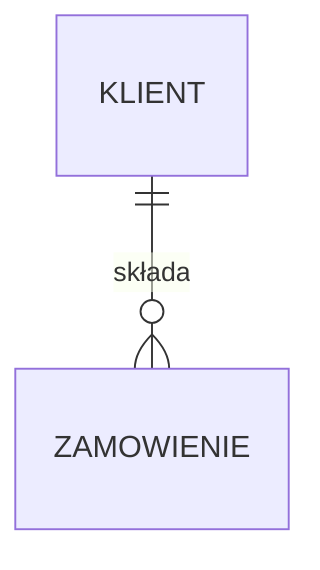

# WdTB-2026-Backend-<uzupełnij: nazwa projektu>

> Karta Waszego projektu z przedmiotu Wprowadzenie do technologii backendowych. Reguła R1.02 sprawdza, czy zastąpiliście wszystkie znaczniki „uzupełnij” w nawiasach ostrych.
> Krótki opis (1–2 zdania) wpisujecie do arkusza zespołów, a tutaj wszystkie szczegóły. Plik jest żywy: aktualizujcie go na każdych zajęciach. Jak wymyślić pomysł: `docs/pomysl.html`.

**Problem w jednym zdaniu:** <uzupełnij>

**Dla kogo (persona):** <uzupełnij: np. „Ola, 22 lata, studentka, chce tanio zjeść po zajęciach”>

**Jak zarabiamy:** <uzupełnij: prowizja / subskrypcja / reklama / …>

## Zespół

Zespół 3-osobowy. Każdy wiersz zaczyna się od loginu GitHub. Pierwsza osoba hostuje repozytorium.
Repozytorium jest publiczne, więc bez e-maili (numery indeksów wpisujecie tylko w wersji w `pom.xml`).

| Login | Imię | Moduł / encje, za które odpowiada |
|---|---|---|
| @<uzupełnij> | <uzupełnij> | <uzupełnij> |
| @<uzupełnij> | <uzupełnij> | <uzupełnij> |
| @<uzupełnij> | <uzupełnij> | <uzupełnij> |

## Historyjki użytkownika (MVP)

Co najmniej 5. Format: `N. Jako <kto> chcę <co>, aby <po co>.`

1. Jako <uzupełnij>
2. Jako <uzupełnij>
3. Jako <uzupełnij>
4. Jako <uzupełnij>
5. Jako <uzupełnij>

## Moduły

| Moduł (pakiet) | Odpowiedzialność | Encje |
|---|---|---|
| `<uzupełnij>` | <uzupełnij> | <uzupełnij> |
| `<uzupełnij>` | <uzupełnij> | <uzupełnij> |

## Diagram ER

## Pytania inwestora (LAB 03)

Pięć pytań biznesowych, na które backend musi umieć odpowiedzieć. Każde ma zapytanie w repozytorium i test.

| # | Pytanie | Metoda repozytorium | Test |
|---|---|---|---|
| 1 | <uzupełnij w LAB 03> | | |

## Dziennik decyzji (ADR-lite)

| LAB | Decyzja | Dlaczego | Alternatywa, którą odrzuciliśmy |
|---|---|---|---|
| 1 | <uzupełnij> | <uzupełnij> | <uzupełnij> |
