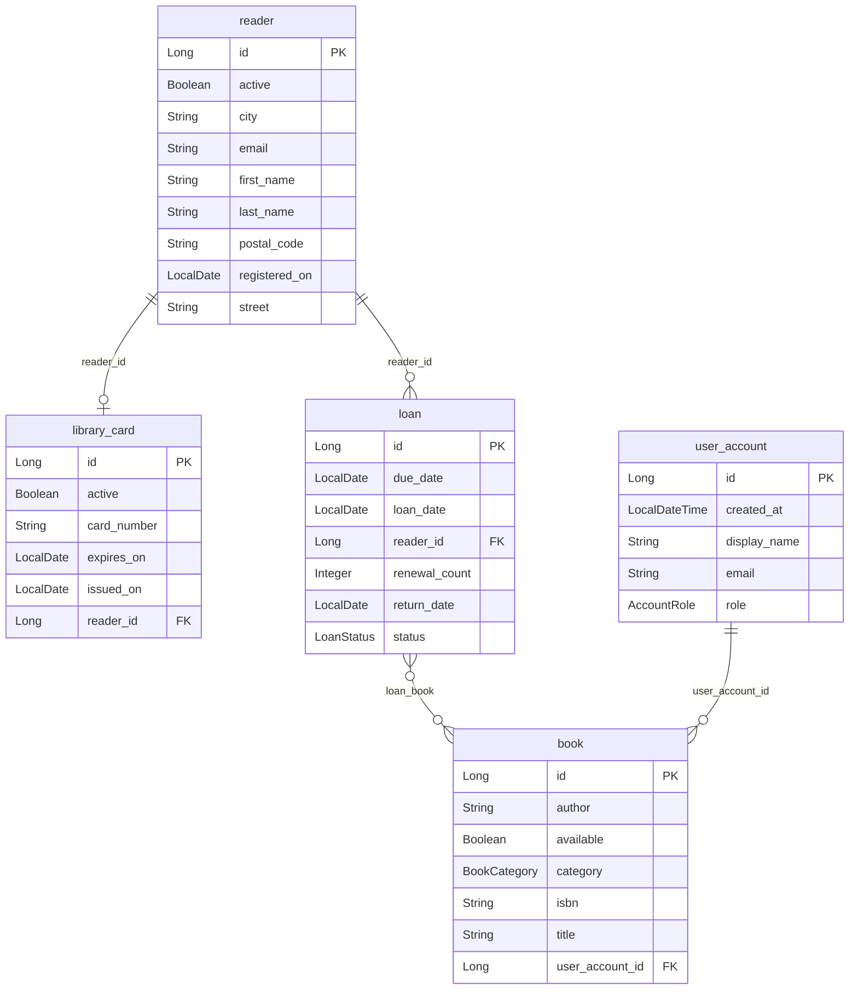

# Schemat bazy danych

Plik generują reguły projektu (panel Maven → Lifecycle → verify). Nie edytujcie go ręcznie.

Tabele: 6 (w tym tabele łączące @ManyToMany: loan_book) · kolumny: 34 · relacje: 2 × @ManyToOne, 1 × @OneToMany, 1 × @OneToOne, 1 × @ManyToMany

| Tabela | Encja | Kolumny | Klucze obce |
|---|---|---|---|
| book | Book | 7 | user_account_id |
| library_card | LibraryCard | 6 | reader_id |
| loan | Loan | 7 | reader_id |
| reader | Reader | 9 | — |
| user_account | UserAccount | 5 | — |

